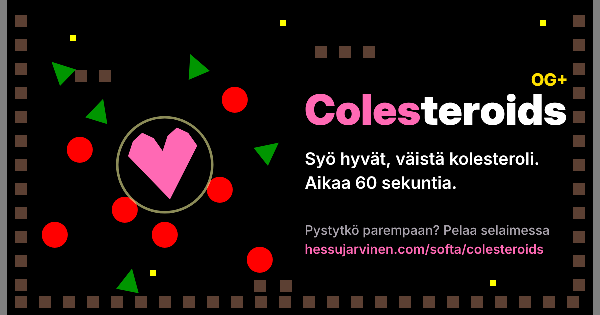

# Colesteroids OG+



**Syö hyvät, väistä kolesteroli. Kuinka monta kenttää selviät?**

Colesteroids on selaimessa pelattava fysiikkapeli. Ohjaat vaaleanpunaista sydäntä nuolinäppäimillä kentässä, jossa leijuu vihreitä kolmioita eli hyviä lipoproteiineja ja punaisia kolesteroliökköjä.

▶ **Pelaa:** https://hessujarvinen.com/softa/colesteroids

## Pelin säännöt

| | |
|---|---|
| 💗 Sydän | Sinä. Nuolinäppäin lyö sydäntä haluamaasi suuntaan, painovoima vetää alas. |
| 🟩 Vihreä kolmio | Hyvä lipoproteiini. Syö: pisteitä ja +10 % energiaa. |
| 🔴 Punainen pallo | Kolesteroliökkö. Törmäys räjäyttää sen ja vie energiaa. |

- Jokainen kenttä kestää 60 sekuntia. Jos energiaa on jäljellä, pääset seuraavaan kenttään ja saat +20 % energiaa.
- Peli päättyy, kun sydämen energia loppuu. Tulos on kaikkien kenttien pisteet yhteensä.
- Jokainen selvitty sekunti antaa 10 pistettä. Uusi kolesteroliökkö ilmestyy 15 sekunnin välein.
- Seiniin aukeaa välillä aukko samalle korkeudelle molemmille puolille. Aukosta lentänyt tulee sisään toiselta puolelta – myös ökköt.
- Tuloksen voi tallentaa nimimerkillä tulostauluun ja jakaa Facebookissa. Jaossa näkyvät nimimerkki, pisteet, kenttä ja leikkimielinen "diagnoosi" tuloksen mukaan.

| Kenttä | 1 | 2 | 3 | 4 | 5 | 6–19 | 20+ |
|---|---|---|---|---|---|---|---|
| Punaisia alussa | 20 | 24 | 28 | 32 | 36 | +2 / kenttä | enintään 70 |
| Punaisten nopeus | 70 | 85 | 100 | 115 | 130 | +5 / kenttä | enintään 250 |
| Osuman energiahävikki | 25 % | 25 % | 30 % | 30 % | 35 % | 35 % | 40 % |
| Vihreän arvo | 100 | 150 | 200 | 250 | 300 | +50 / kenttä | +50 / kenttä |
| Vihreitä | 20 | 18 | 16 | 14 | 12 | 10 | 10 |

### Kentät

Pelissä on 50 kenttää. Kenttä 1 on alkuperäinen vuoden 2019 kenttä, kentät 2–5 tehtiin käsin ja kentät 6–50 generoitiin ohjelmallisesti. Jokainen generoitu kenttä on tarkistettu: aloituspaikka on vapaa, seinien vierustat ovat auki aukkoja varten ja kaikki alueet ovat saavutettavissa. Kentän 50 jälkeen kentät kiertävät alusta.

<details>
<summary>Kaikki 50 kenttää</summary>

1. Alkuperäinen sydänalue (2019)
2. Aortan portaat
3. Laskimoiden käytävät
4. Sydämen kammiot
5. Hiussuonisokkelo
6. Keuhkovaltimon kiito
7. Hemoglobiinihissi
8. Punasolujen ruuhkatunti
9. Läppävikalabyrintti
10. Kapillaarikarnevaali
11. Imusuonten ihmemaa
12. Maksan suodatinmaasto
13. Munuaiskerästen kiemurat
14. Ohutsuolen mutkat
15. Pernan pallomeri
16. Kaulavaltimon kaarre
17. Sepelvaltimoiden solmu
18. Verihiutaleiden hyppyrit
19. Plasmaputki
20. Valkosolujen vartiovuoro
21. Palleaplaneetta
22. Aivokuoren poimut
23. Selkäytimen pikakaista
24. Hermoratojen hyppely
25. Synapsisilta
26. Sydänpussin pomppulinna
27. Eteisvärinäkaaos
28. Kammiovärinän vuoristorata
29. Diastolen lepotauko
30. Systolen syöksy
31. Verenpainepiikki
32. Kolesterolikaupunki
33. Plakkiputken ahdinko
34. Rasvahappojen rodeo
35. Insuliinipuisto
36. Glukoosigalleria
37. Hapenottoareena
38. Hiilidioksidihuuhtelu
39. Keuhkorakkuloiden arvoitus
40. Henkitorven tuulitunneli
41. Luuytimen lastentarha
42. Fibriiniverkko
43. Hyytymiskaskadi
44. Vasemman kammion valtatie
45. Oikean eteisen odotushuone
46. Ohitusleikkauksen kiertotie
47. Pallolaajennuksen paikka
48. Stenttien sokkelo
49. Sykevälivaihtelu
50. Ison verenkierron finaali

</details>

### Äänet

Äänitehosteet syntetisoidaan pelissä Web Audio -rajapinnalla, joten erillisiä äänitiedostoja ei ole: syöminen, räjähdys, pomput seinistä, nuolinäppäimen puhallus, seinäaukon varoitus ja avautuminen, läpilento, uusi kolesteroliökkö, kentän läpäisy ja pelin loppu. Äänet saa pois vasemman alakulman painikkeesta tai **M**-näppäimellä.

Näppäimet: nuolet liikuttavat, **M** mykistää äänet, **F1** näyttää ohjeet ja **Esc** lopettaa pelin.

## Tausta

Alkuperäinen Colesteroids syntyi vuonna 2019 Jyväskylän yliopiston Ohjelmointi 1 -kurssilla. Se kirjoitettiin C#-kielellä yliopiston [Jypeli](https://github.com/Jypeli-JYU/Jypeli)-pelikirjastolla, ja siitä puuttuivat vielä alkunäyttö, tulostaulu ja kunnollinen pistelasku.

Colesteroids OG+ (2026) on sen paranneltu selainversio, joka on vibekoodattu Clauden kanssa. Kenttä, hahmot ja fysiikan oletusarvot on siirretty alkuperäisestä koodista mahdollisimman uskollisesti, ja alkuperäisen koodin TODO-kommenteista on tehty varsinainen pelimekaniikka.

## Hakemistot

```
web/             Selainversio
  index.html     Peli (yksi HTML-tiedosto, ei riippuvuuksia)
  scores.php     Yhteinen tulostaulu (PHP, tallentaa tiedostoon data/scores.json)
  share.php      Yhden tuloksen jakosivu Facebookia varten (nimimerkki ja pisteet otsikossa)
  share-image.php  Tuloksen jakokuva, piirretään og-base.png:n päälle (PHP GD)
  share_lib.php  Yhteiset apufunktiot
  og-image.png   Pelin yleinen jakokuva (Facebook / Open Graph)
  og-base.png    Pohjakuva tuloskohtaisille jakokuville
  fonts/         Inter-fontti jakokuviin (SIL Open Font License 1.1)
original-2019/   Alkuperäinen C#/Jypeli-projekti (Visual Studio for Mac)
```

### Selainversion ajaminen

Vie `web`-kansion sisältö palvelimelle, jossa on PHP 7.4 tai uudempi. Peli käyttää silloin yhteistä tulostaulua `scores.php`:n kautta. Palvelin laskee pisteet kentittäin samalla kaavalla kuin peli. Tulostaulussa on yksi rivi per nimimerkki, ja se päivittyy vain paremmalla tuloksella. Nimimerkki varataan selaimelle, joka tallentaa sillä ensimmäisen kerran: selain lähettää satunnaisen tunnisteen, josta palvelin säilyttää vain tiivisteen. `scores.php` luo ensimmäisellä tallennuksella `data`-kansion ja suojaa sen `.htaccess`-tiedostolla. Palvelin tarkistaa, että pisteet vastaavat pelin sääntöjä, ja rajoittaa tallennustahtia.

Jos PHP:tä ei ole tai avaat `index.html`:n suoraan tiedostona, tulostaulu tallentuu pelaajan omaan selaimeen (localStorage).

Julkaisu sivustolle tapahtuu GitHub Actionsilla (`.github/workflows/deploy.yml`) aina, kun `web`-kansio muuttuu `main`-haarassa.

### Alkuperäinen versio

`original-2019` sisältää vuoden 2019 lähdekoodin sellaisenaan. Jypeli-kirjastot palautetaan NuGetillä (`packages.config`). Projektiin kuuluneet macOS-natiivikirjastot (`libSDL2-2.0.0.dylib`, `libopenal.1.dylib`) eivät ole repossa, koska ne ovat kolmannen osapuolen binäärejä.

## Lisenssi

Jakokuvissa käytetty Inter-fontti on The Inter Project Authorsin ja julkaistu SIL Open Font License 1.1 -lisenssillä (`web/fonts/OFL.txt`).


[MIT](LICENSE) © 2026 Hessu Järvinen. Colesteroids on Hessu Järvisen alkuperäinen idea. Saat parannella koodia vapaasti, kunhan tekijänoikeusilmoitus säilyy mukana.
